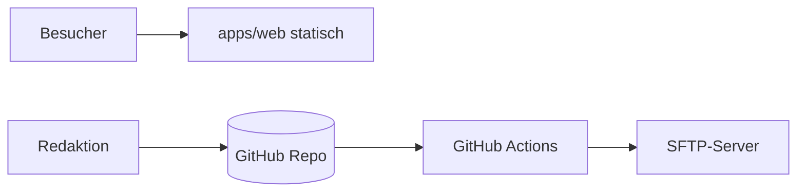

# Architektur <Projektname>

## Überblick
Ein Absatz und ein Diagramm (Mermaid), welche Teile es gibt und wie sie zusammenhängen.

## Bausteine
| Baustein | Ort | Aufgabe | Technik |
|---|---|---|---|

## Inhalte und Daten
Welche Inhalte es gibt, wo sie liegen (JSON in `apps/web/src/content/`, Datenbank), Schemas in `packages/shared`.

## Schnittstellen
Je Endpunkt: Methode, Pfad, Schema der Anfrage und Antwort, Fehlerfälle. Bei statisch: entfällt.

## Redaktion
Wer pflegt was, wie kommt eine Änderung online, was ist gesperrt.

## Qualität
Wie Barrierefreiheit, Datenschutz, Leistung und Sicherheit erreicht und geprüft werden.

## Betrieb
Hosting, Domain, Secrets (nur Namen), Kosten, Überwachung.

## Entscheidungen
| ADR | Entscheidung | Status |
|---|---|---|

## Annahmen für die Gegenrede
- <Annahme, an der der Entwurf scheitern könnte>

## Gegenrede
Befunde des Advocatus Diaboli und wie damit umgegangen wurde.

## Verbunden
- [[prd]]
- [[glossar]]
