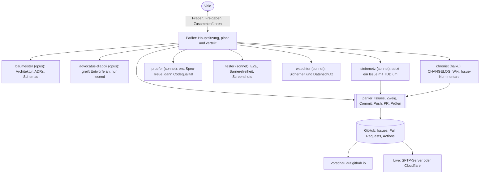
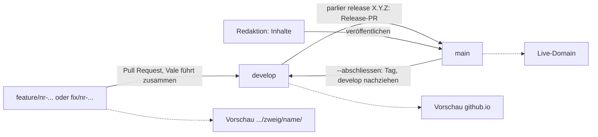
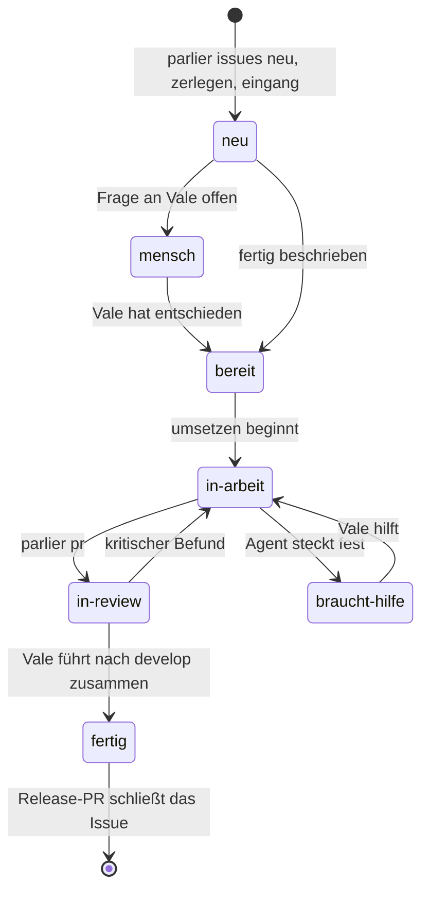
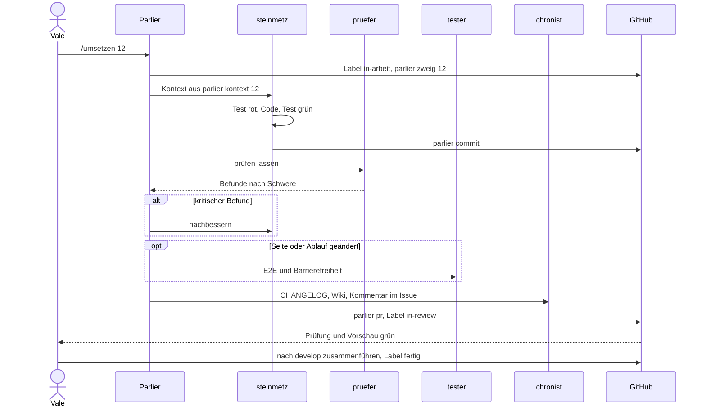
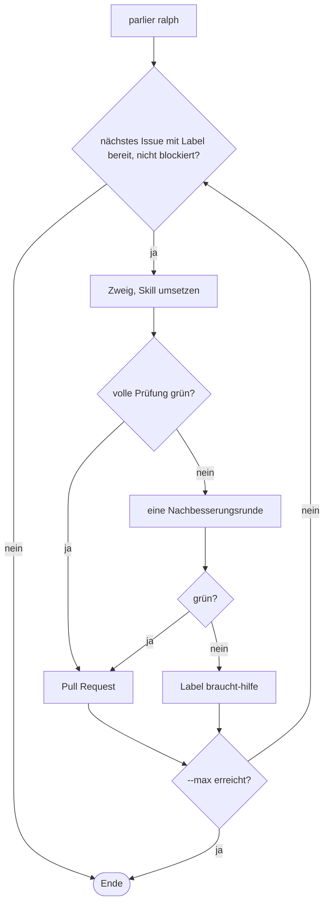

# Zusammenarbeit

## Rollen und Werkzeuge

Die Hauptsitzung von Claude Code ist der **Parlier**: Sie spricht mit Vale, plant und verteilt die Arbeit an
Subagenten mit festen Rollen. Handarbeit (Git, Issues, Prüfen) erledigt das Skript `parlier`, damit dafür keine
Tokens anfallen. Vale gibt PRD und Architektur frei, führt zusammen und macht Releases.



| Phase | Wer arbeitet | Ergebnis |
|---|---|---|
| 0 Eingang | Parlier | Issues aus Mails, Dokumenten, Screenshots |
| 1 Interview | Parlier mit Vale | `anf.md`, Glossar |
| 2 PRD | Parlier | `prd.md`, Freigabe durch Vale |
| 3 Architektur | baumeister, dann advocatus-diaboli | `architektur.md`, ADRs, Vertrag, Freigabe durch Vale |
| 4 Zerlegung | Parlier | Issues als vertikale Slices mit Abhängigkeiten |
| 5 Umsetzung | steinmetz, pruefer, tester, chronist | Pull Request nach `develop` |
| 6 Review | pruefer, tester, waechter | Befunde nach Schwere |
| 7 Release | chronist, waechter, Vale | Release-PR nach `main`, Tag |

## Zwei Wege, je nach Art der Änderung

| Art | Wer | Weg | Geht live |
|---|---|---|---|
| **Inhalte**: Texte, Bilder, Termine | Pflegende | Redaktion, Veröffentlichen (schreibt nach `main`) | sofort |
| **Technik und Design** | Vale mit Claude | Issue, Zweig, Pull Request nach `develop`, Testseite | mit dem nächsten Release |

## Zweige

| Zweig | Wofür | Zu sehen |
|---|---|---|
| `main` | was live ist, plus Inhalte aus der Redaktion | Live-Domain |
| `develop` | Sammelstelle bis zum nächsten Release | `https://<konto>.github.io/<repo>/` |
| `feature/<nr>-...`, `fix/<nr>-...` | ein Issue | `.../zweig/<name>/`, Übersicht `.../zweig/` |

Claude arbeitet nur auf `feature/` und `fix/` und nur über parlier. Zusammenführen und Releases macht Vale.



## Issues und Labels

Ohne Issue keine Arbeit: Auch Interview, PRD und Architektur haben ein Issue. Fragen, Antworten und
Entscheidungen stehen als Kommentare darin. `parlier` lehnt Zweige und Commits ohne Issue-Nummer ab.



| Label | Bedeutung |
|---|---|
| `wunsch`, `fehler`, `inhalt`, `technik`, `design`, `recht`, `betrieb` | Art |
| `bereit` | fertig beschrieben, ein Agent darf es allein umsetzen (AFK) |
| `mensch` | braucht eine Entscheidung oder Zulieferung von Vale (HITL) |
| `in-arbeit`, `in-review` | gerade dran, PR offen |
| `fertig` | auf `develop`, geht mit dem nächsten Release live (setzt der Workflow) |
| `braucht-hilfe` | Agent ist steckengeblieben |
| `keine-doku` | PR braucht ausnahmsweise keinen Doku-Eintrag |
| `claude` | Claude soll das Issue sichten (GitHub Action) |

Abhängigkeiten stehen im Issue als `Blockiert von: #12, #13`. Ralph nimmt ein Issue erst, wenn diese
geschlossen oder `fertig` sind.

## Ablauf eines Issues



## Ralph (AFK)

Ralph arbeitet Issues mit Label `bereit` ab, während niemand zuschaut. Er läuft im Sandbox-Container, weil
Claude dort ohne Rückfragen arbeitet:

```bash
docker build -t bauhuette-sandbox sandbox
docker run -it --rm -v "$PWD":/arbeit -e CLAUDE_CODE_OAUTH_TOKEN -e GH_TOKEN bauhuette-sandbox
pnpm install
python3 -m parlier ralph --trocken   # zeigt das nächste Issue
python3 -m parlier ralph --max 3
```

Pro Issue: Zweig, Skill `umsetzen`, volle Prüfung, eine Nachbesserungsrunde, dann Pull Request oder Label
`braucht-hilfe`.


 Protokoll mit Dauer und Kosten in `.bauhuette/protokoll/`. Grenzen in `bauhuette.toml`
unter `[ralph]`.

## Release

```bash
git switch develop && git pull
python3 -m parlier release 1.2.0
# Release-PR auf GitHub mit "Create a merge commit" zusammenführen
python3 -m parlier release 1.2.0 --abschliessen --titel "Termine als Kalender"
```

| Version | Wann |
|---|---|
| `X.0.0` | Neuaufbau oder grundlegend anderes Aussehen |
| `x.Y.0` | mindestens eine neue Funktion oder Seite |
| `x.y.Z` | nur Fehlerbehebungen |

Notfall: `fix/<nr>-...` von `main`, `parlier pr --basis main`, danach `main` nach `develop` holen.

## Claude auf GitHub

`@claude` in einem Issue oder Kommentar startet Claude in GitHub Actions. Label `claude` an einem Issue lässt
es sichten (Labels, Dubletten, Rückfragen). Braucht das Secret `CLAUDE_CODE_OAUTH_TOKEN`.

## Verbunden

- [[betrieb]]
- [[glossar]]
